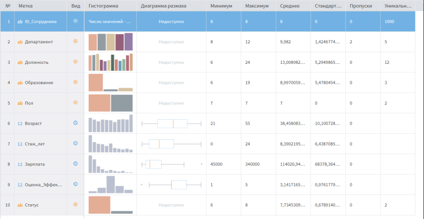
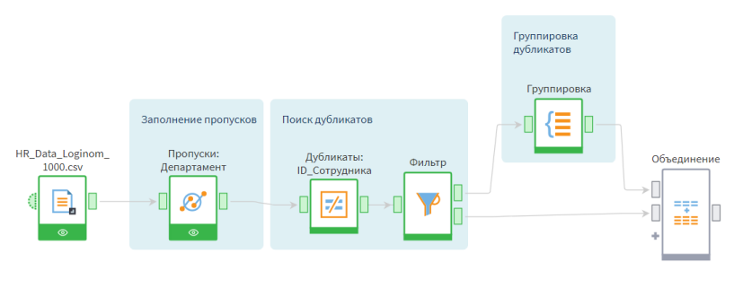
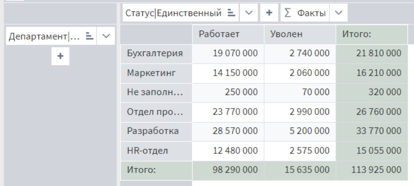
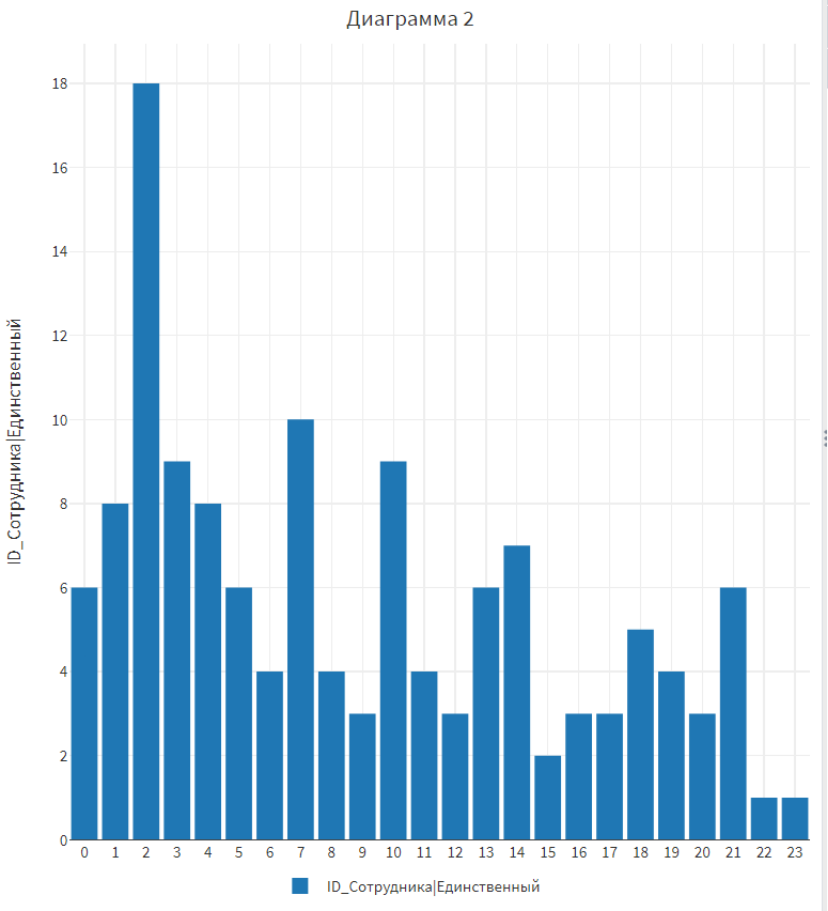
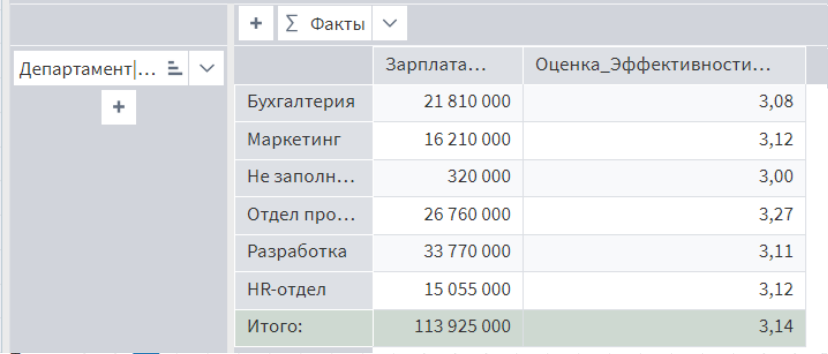
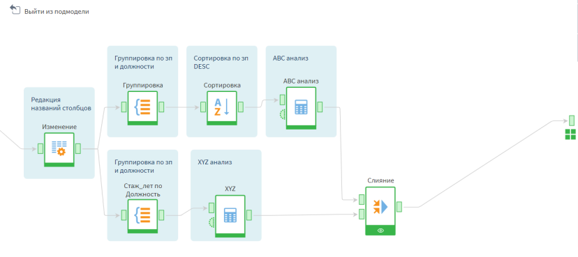
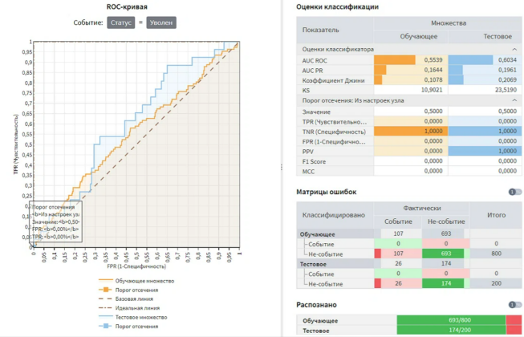
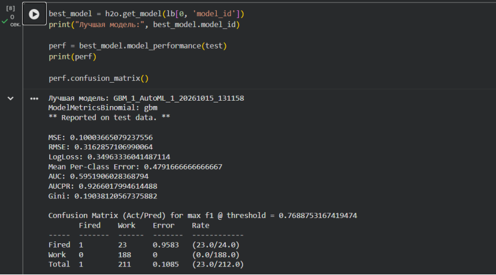

# Анализ HR-данных в Loginom

## О проекте
Учебный проект по анализу HR-данных (1000 сотрудников) с использованием платформы Loginom. 
Цель: провести очистку данных, построить OLAP-кубы для анализа текучести кадров и ФОТ, а также использовать методы машинного обучения.

**Инструменты:** Loginom, H2O, Colab (AutoML).

**Ссылка на выполненный проект Loginom:** https://drive.google.com/file/d/1zZ3NsNvcwLQ3TJJmz55hh_tGxccx8MYC/view?usp=sharing
**Ссылка на Colab (дерево решений и AutoML):** https://colab.research.google.com/drive/1wOgKEUcY1tIby3reKkoBaNL_Zs-mlvVY?usp=sharing

## Этап 1. Исходные данные и очистка
Объектом анализа выступает учебный HR-датасет «HR_Data_Loginom_1000.csv», включающий данные о сотрудниках (департамент, должность, зарплата, оценка эффективности, статус и т.д.).

**Первичная статистика:**

В ходе очистки было принято решение не удалять пропуски в департаментах, а заполнить их текстом «Не заполнено», чтобы сохранить всех сотрудников в выборке (1000 уникальных записей) и не потерять информацию о тех, у кого не был указан департамент. Также были удалены 2 скрытых дубликата по ID сотрудника. 

**Схема очистки в Loginom:**

## Этап 2. Аналитика в OLAP-кубах

В результате анализа были построены кросс-таблицы для оценки структуры персонала.

**1. Сравнение ФОТ и средней оценки эффективности по Департаментам:**
Наибольший ФОТ у отдела «Разработка» (33 770 тыс. руб.). 

**2. Распределение увольнений по стажу работы:**
Пик увольнений приходится на 2 года стажа (18 человек), что говорит о том, что компания теряет сотрудников в период адаптации. 

**3. Оценка эффективности (KPI):**

Средняя оценка в «Разработке» — 3.11, что ниже, чем в «Отделе продаж» (3.27).

## Этап 3. ABC-XYZ анализ и Машинное обучение

**ABC-XYZ анализ должностей:**
В ходе сегментации выяснилось, что все должности попали в группу Z по стажу из-за того, что стаж сотрудников на одной и той же должности сильно различается (от 6 до 24 лет). Группа AX отсутствует, нет ни одной должности, которая была бы одновременно дорогой и стабильной по стажу.

**Машинное обучение (Логистическая регрессия):**
Была построена модель для прогнозирования увольнения. Модель логистической регрессии показала низкую предсказательную способность (AUC ROC около 0,55). Это означает, что возраст, стаж и зарплата сами по себе не определяют, уволится сотрудник или нет. Для построения точного прогноза нужны другие данные: например, оценка эффективности, результаты опросов удовлетворенности, отношения в коллективе или отношения с руководством

## Главные выводы
1. **Текучесть кадров:** Больше всего увольнений в HR-отделе. Пик приходится на первые 2 года работы, это значит, что компании нужно улучшать онбординг.
2. **ФОТ:** Самый дорогой департамент - Разработка (33 770 тыс. руб.), но средняя оценка эффективности там 3,11 - ниже, чем в Отделе продаж (3,27) и Маркетинге (3,12). Стоит проверить нагрузку и KPI разработчиков.
3. **Машинное обучение:** Для точного прогноза увольнений имеющихся признаков недостаточно. Нужны другие данные, например  оценка эффективности, результаты опросов удовлетворенности, отношения в коллективе или отношения с руководством.

---
**Автор:** Щербакова Екатерина
