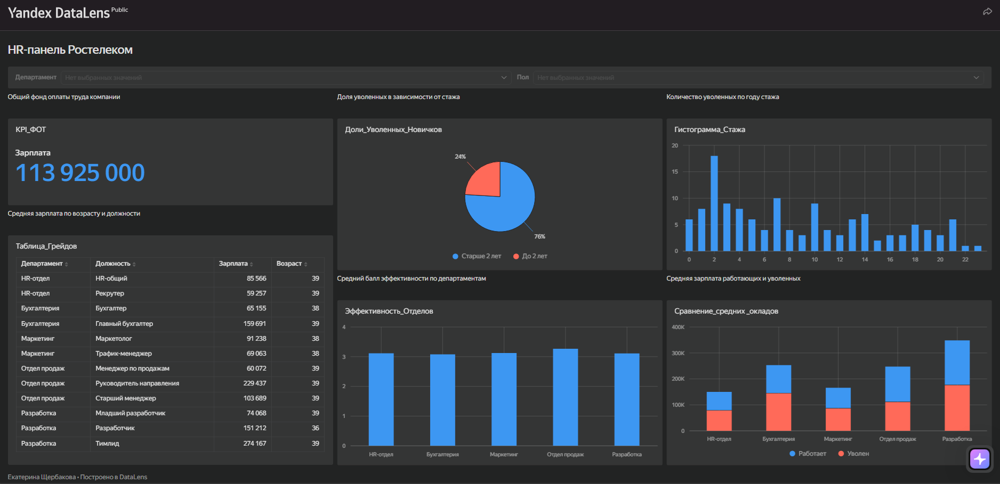
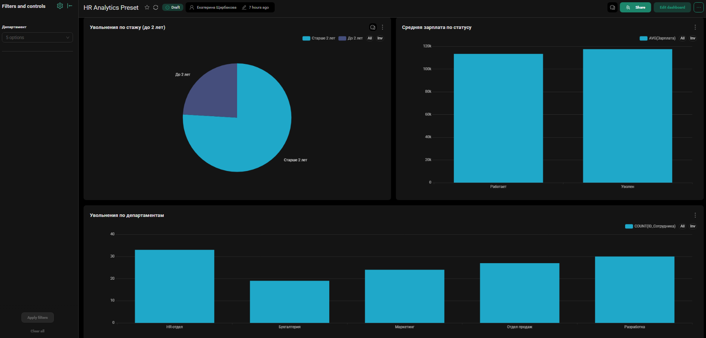

# Модуль 3: Визуализация данных в BI-инструментах

В рамках данного модуля были освоены инструменты бизнес-анализа и интерактивной визуализации данных. 

**Использованные инструменты:** Yandex DataLens, Preset (Superset), Google Colab, BigQuery.

## Основное задание: Дашборд в Yandex DataLens

Через облачную среду Yandex DataLens был собран интерактивный дашборд по HR-данным, фиксирующий показатели 1000 сотрудников компании. На панели отображены ключевые метрики: ФОТ, текучесть кадров, средние оценки эффективности по департаментам и должностные грейды. Добавлены интерактивные фильтры по департаменту и полу.

🔗 **[Ссылка на интерактивный дашборд в DataLens](https://datalens.yandex/z9snl4ujnjtoi?_share_link=public)**

**Ключевые выводы по DataLens:**
1. **Текучесть кадров.** Больше всего сотрудников увольняется в первые два года работы. Это говорит о том, что компания теряет сотрудников в период адаптации и ей стоит обратить внимание на адаптацию новых сотрудников или условия на старте.
2. **Зарплаты уволенных.** В большинстве департаментов (Бухгалтерия, HR, Маркетинг, Разработка) средняя зарплата уволившихся *выше*, чем у работающих. То есть уходят не только низкооплачиваемые сотрудники.
3. **Эффективность и ФОТ.** Самый дорогой департамент — Разработка (34 млн руб.), но средняя оценка эффективности там 3.1. Это ниже, чем в Отделе продаж (3.3), который стоит дешевле.

## Дополнительное задание: BigQuery и Preset (Superset)

Данные были загружены в облачное хранилище BigQuery с помощью облачного блокнота в Google Colab. После предварительного анализа в BigQuery, данные были визуализированы в Preset.

🔗 **[Ссылка на дашборд в Preset](https://a5d376f4.us1a.app.preset.io/superset/dashboard/p/W1Lqlgqen4J/)**

**Ключевые выводы по Preset:**
1. Почти четверть (24%) всех уволенных сотрудников проработали в компании менее двух лет. Это подтверждает гипотезу о том, что компания теряет людей на этапе адаптации.
2. Средняя зарплата уволенных (около 117 тыс. руб.) выше, чем у работающих (около 113 тыс. руб.). Это значит, что компания теряет квалифицированных и дорогих специалистов.
3. Наибольшее количество увольнений зафиксировано в HR-отделе и отделе Разработки. Это может говорить о специфике рынка труда для этих специалистов (высокая конкуренция, выгорание), тогда как в бухгалтерии штат более стабилен.
